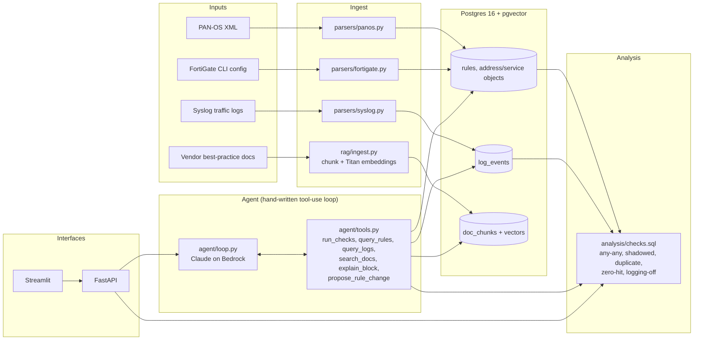

# Architecture

Every vendor's config is normalized into one `Rule` model at the parser boundary;
everything downstream (SQL checks, agent, API) only sees the vendor-neutral schema.

`propose_rule_change` only suggests changes; nothing is ever applied to a device.
